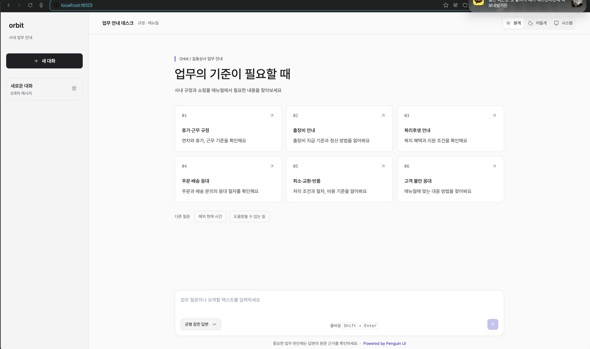
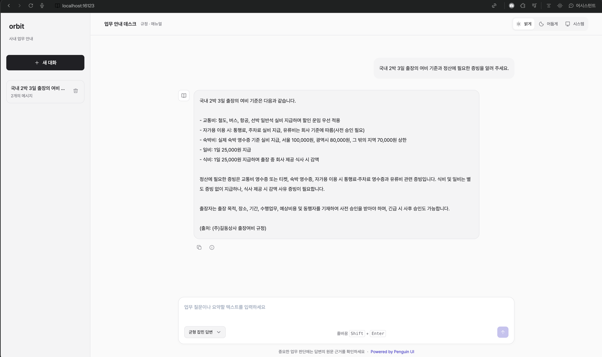

# Orbit — 길동상사 사내 업무 안내 에이전트

가상의 회사 (주)길동상사의 사내 규정과 쇼핑몰 고객 응대 업무를 안내하는 AI 에이전트입니다.





웹 화면은 Tailwind CSS, Penguin UI, Alpine.js로 구성합니다. LangChain·LangGraph 기반 Supervisor가 질문에 따라 전문 에이전트와 도구를 호출합니다. 규정 검색에는 PostgreSQL·pgvector를, 대화 저장에는 별도 PostgreSQL 체크포인터를 사용하며, 대화·임베딩 모델은 OpenAI 모델을 사용합니다.

## 주요 기능

| 기능                 | 지원 범위                                                                   |
| -------------------- | --------------------------------------------------------------------------- |
| 인사 규정 안내 (RAG) | 취업규칙의 근무·휴가 기준, 출장여비 지급·정산 기준, 복리후생 지원 조건 검색 |
| 쇼핑몰 CS 안내 (RAG) | 주문·결제·배송·취소·교환·반품·환불 및 고객 불만 응대 매뉴얼 검색            |
| 텍스트 요약          | 사용자가 제공한 원문 요약, 원문 대조 및 최대 2회 수정                       |
| 현재 시간 조회       | 국가명·국가 코드 또는 IANA 시간대의 현재 날짜와 시간 조회                   |
| 기능 소개            | Supervisor에 등록된 도구를 바탕으로 지원 기능 안내                          |

규정과 매뉴얼에 관한 답변은 검색 결과와 출처를 기반으로 제공합니다. 실제 인사 신청, 주문 조회·변경, 환불이나 지원금 지급은 수행하지 않습니다. 검색 근거가 부족하거나 도구가 지원하지 않는 요청은 확인할 수 없다고 안내합니다.

검색 원본은 저장소의 `data/`에 있는 PDF입니다. 모두 가상의 회사 길동상사를 위해 작성한 예제 문서이며, 실제 회사의 규정이 아닙니다.

웹에서는 6개 업무 카드로 질문을 시작하고 대화방을 생성·선택·삭제할 수 있습니다. 밝게·어둡게·시스템 테마, 응답 스트리밍, 답변 복사와 요청별 LLM 토큰 사용량 표시를 지원합니다. 토큰 사용량은 모델이 보고한 입력·출력 합계이며 임베딩 사용량은 제외합니다.

## 개발 환경과 실행

### VS Code Dev Container

Docker와 VS Code의 **Dev Containers** 확장을 설치한 뒤 프로젝트 폴더를 엽니다. 명령 팔레트에서 **Dev Containers: Reopen in Container**를 실행하세요.

초기화 스크립트는 `.env`가 없으면 `.env.example`을 복사합니다. `.env`의 OpenAI API 키와 DB 설정을 확인하세요. 컨테이너가 시작되면 API 서버와 웹, 벡터 DB, 대화 DB가 함께 실행됩니다. Python 인터프리터는 `/opt/venv/bin/python`이며, Python 소스를 변경하면 API 서버가 자동으로 다시 로드됩니다.

### Docker

Dev Container를 사용하지 않는 경우 저장소 루트의 `docker-compose-local.yml`로 실행합니다. `.env`가 없다면 `.env.example`을 복사하고 OpenAI API 키와 DB 설정을 입력하세요. `agent` 컨테이너는 이 파일에서 설정을 읽습니다.

컨테이너 내부 DB 주소는 `VECTOR_DB_HOST=vector-db`, `MEMORY_DB_HOST=memory-db`이며 포트는 모두 `5432`입니다. Dev Container와 일반 Docker 실행은 서비스와 포트를 공유하므로 동시에 시작하지 마세요.

- OpenAI 키 발급: https://platform.openai.com/api-keys

```sh
docker compose -f docker-compose-local.yml up --build -d
docker compose -f docker-compose-local.yml logs -f agent
```

| 서비스    | 호스트 접속 주소             | 컨테이너 내부 주소 |
| --------- | ---------------------------- | ------------------ |
| web       | http://localhost:16123       | web:80             |
| agent     | http://localhost:16124/docs  | agent:8000         |
| vector-db | localhost:16125 (PostgreSQL) | vector-db:5432     |
| memory-db | localhost:16126 (PostgreSQL) | memory-db:5432     |

DB는 루트 `.env`의 `VECTOR_DB_USERNAME`, `VECTOR_DB_PASSWORD`,
`VECTOR_DB_DATABASE`를 읽어 PostgreSQL의 `POSTGRES_*` 변수로 매핑합니다.
대화 저장용 DB도 `MEMORY_DB_*` 설정을 같은 방식으로 읽습니다.

`./run.sh`로 서비스를 시작할 수도 있습니다. 이 스크립트는 `up -d`를 실행하므로 이미지 재빌드가 필요하면 위의 `--build` 명령을 사용하세요.

`shutdown.sh`를 이용해 종료할 경우 DB 볼륨도 삭제합니다. DB를 보존하려면 아래 명령을 사용하세요.

```sh
docker compose -f docker-compose-local.yml down
```

### 문서 임베딩

규정 검색을 사용하려면 `data/`의 PDF를 벡터 DB에 적재해야 합니다.

- [취업규칙](<./data/취업규칙%20-%20(주)길동상사.pdf>)
- [복리후생 규정](<./data/복리후생%20규정%20-%20(주)길동상사.pdf>)
- [출장여비 규정](<./data/출장여비%20규정%20-%20(주)길동상사.pdf>)
- [쇼핑몰 CS 실무 매뉴얼](<./data/쇼핑몰%20CS%20실무%20매뉴얼%20-%20(주)길동상사.pdf>)

DB가 실행 중이고 API 키가 설정된 상태에서 명령을 실행합니다. Dev Container에서는 프로젝트 루트에서 실행하세요.

```sh
uv run python src/app/doc_importer.py
```

일반 Docker 실행 환경에서는 `agent` 컨테이너에서 실행합니다.

```sh
docker compose -f docker-compose-local.yml exec agent uv run python src/app/doc_importer.py
```

이 작업은 임베딩 API를 호출하고 DB에 문서를 추가합니다. 기존 문서 삭제나 중복 제거를 수행하지 않으므로 재실행 시 중복 적재될 수 있습니다.

### 접속

서비스 실행과 문서 적재가 끝나면 웹은 http://localhost:16123, API 명세는 http://localhost:16124/docs에서 확인합니다.

### 코드 포맷과 커밋 검사

Python은 Black, 웹 자산과 문서는 Prettier를 사용합니다. 저장소 루트에서 개발 도구 의존성을 설치하고 필요한 검사를 실행하세요.

```sh
npm ci
npx prettier --check README.md web/index.html web/assets/css/app.css
uv run black --check src/app
```

`npm ci`는 Husky 훅을 설치합니다. 커밋 시 lint-staged가 스테이징된 파일에 Prettier를 적용하고, commitlint가 커밋 메시지를 검사합니다. 전체 포맷 검사는 `npm run format:check`, 전체 포맷 적용은 `npm run format`을 사용합니다.

## HTTP API

웹 채팅은 `/chat/stream`으로 응답을 받습니다. 저장된 대화는 관리자 API `/admin/conversations/{thread_id}`로 조회합니다. 상세 요청·응답 스키마는 http://localhost:16124/docs에서 확인하세요.

| 메서드 | 경로                               | 용도                               |
| ------ | ---------------------------------- | ---------------------------------- |
| POST   | `/chat`                            | 채팅 응답과 토큰 사용량 반환       |
| POST   | `/chat/stream`                     | SSE로 답변 스트리밍                |
| GET    | `/admin/conversations/{thread_id}` | 저장된 대화의 최신 체크포인트 조회 |

채팅 요청은 최대 1,000자의 `message`와 선택적인 UUID `thread_id`를 받습니다. 같은 대화를 이어가려면 동일한 `thread_id`를 전달합니다. 생략하면 새 UUID가 생성됩니다. 스트리밍은 `start`, `token`, `done`, `error` 이벤트를 사용합니다.

관리자 대화 조회는 `.env`의 `ADMIN_API_KEY`를 설정하고 요청 헤더 `X-Admin-API-Key`로 전달해야 합니다. 키가 비어 있으면 503, 인증이 맞지 않으면 403, 저장된 대화가 없으면 404를 반환합니다. `namespace` 쿼리로 체크포인트 namespace를 지정할 수 있으며, 기본값은 루트 namespace입니다. 관리자 키를 웹 코드에 넣지 마세요.

## Skills

프로젝트 개발 작업에 사용하는 Codex 스킬은 `.agents/skills/`에서 관리합니다. 각 스킬의 적용 기준은 [AGENTS.md](AGENTS.md)에 안내되어 있으며, 웹 채팅 에이전트의 도구와는 별개입니다.

| 스킬                                                     | 용도                                                                                | 사용 예시                                    |
| -------------------------------------------------------- | ----------------------------------------------------------------------------------- | -------------------------------------------- |
| [git-commit](.agents/skills/git-commit/SKILL.md)         | 타입별 gitmoji와 한글 설명을 사용하는 Conventional Commits 메시지 작성 및 커밋 생성 | `$git-commit`                                |
| [code-review](.agents/skills/code-review/SKILL.md)       | 에이전트·웹·Docker 및 관련 설정의 변경 검토와 수정안 제시                           | `$code-review 스테이징된 변경을 리뷰해줘`    |
| [security-check](.agents/skills/security-check/SKILL.md) | 민감정보 노출, 위험한 코드·설정, 의존성 취약점과 deprecated API 점검                | `$security-check 스테이징된 변경을 점검해줘` |

`$git-commit`만 호출하면 현재 스테이징된 변경을 보안 점검·필요한 코드 리뷰·검증 후 커밋합니다. 미스테이징 변경과 미추적 파일은 자동으로 추가하지 않으며, 스테이징이 비어 있으면 종료합니다. 커밋 메시지는 `type(scope): gitmoji 한글 설명` 형식이며, scope는 `.vscode/settings.json`의 허용 목록에서 선택합니다.

코드 리뷰와 보안 점검에서 문제가 발견되면 발견 사항과 수정안을 먼저 보고하고, 사용자 승인 후 수정합니다. 메시지 초안만 요청한 경우에는 커밋을 생성하지 않습니다.

## 라이선스

이 프로젝트는 [MIT 라이선스](LICENSE)를 따릅니다. 외부 라이브러리와 자산에 포함된 별도 라이선스 및 저작자 표기는 해당 조건을 따릅니다.
